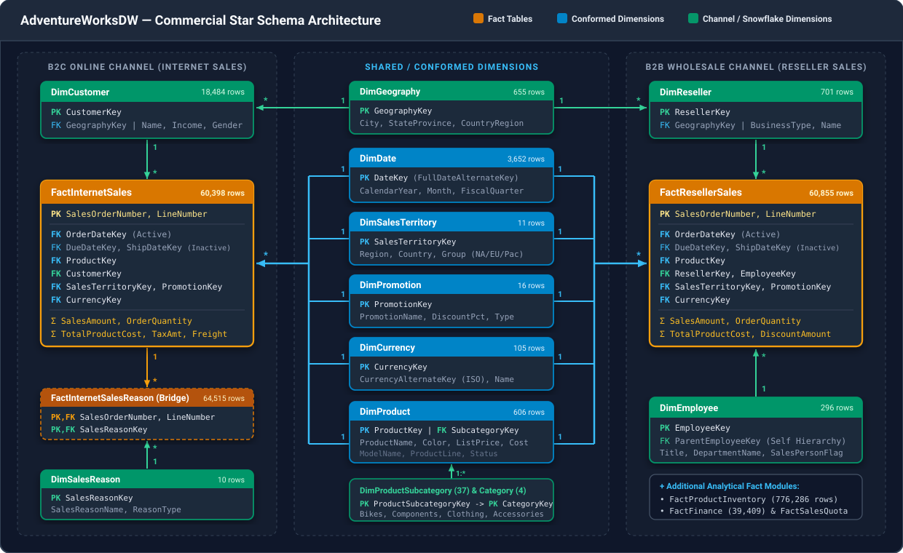
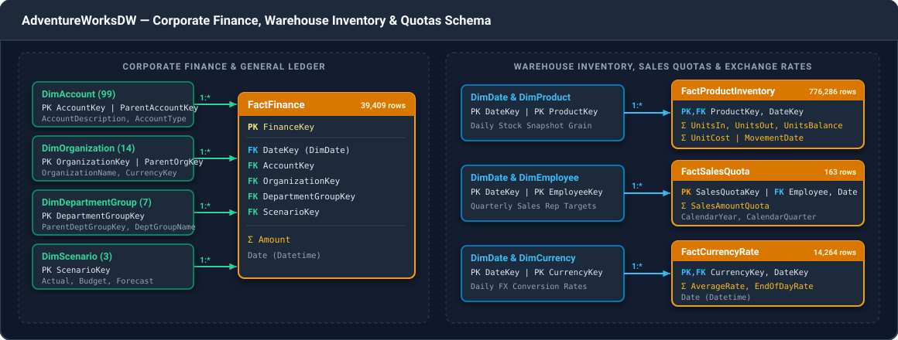

# 03 — Star Schema & Dimensional Modeling Guide

`AdventureWorksDW` is built using **Kimball Dimensional Modeling** principles. Understanding how its **Fact tables** and **Dimension tables** connect will save you hours of trial and error when building relationships in Power BI, SQL, or Analysis Services.

---

## 1. Core Concepts Used in This Dataset

1. **Fact Tables (`Fact*`)**: Store quantitative business measurements and events (sales orders, daily inventory movements, financial ledger entries, sales quotas). They are "narrow and tall" — consisting mostly of numeric **Foreign Keys (`*Key`)** and numeric **measures** (`SalesAmount`, `OrderQuantity`, `TotalProductCost`).
2. **Dimension Tables (`Dim*`)**: Store descriptive context (*Who, What, Where, When, Why*) used to filter, group, and slice Fact tables.
3. **Surrogate Keys vs. Alternate Keys**:
   - **Surrogate Key (`*Key`)**: An integer primary key generated by the Data Warehouse (e.g., `ProductKey = 310`). **Always join tables using `*Key` columns!**
   - **Alternate Key (`*AlternateKey`)**: The original natural/business key from the ERP system (e.g., `ProductAlternateKey = "BK-R93R-62"`). Because `DimProduct` and `DimEmployee` use **Slowly Changing Dimensions (SCD Type 2)** to track historical cost/status changes over time, multiple `ProductKey` rows can share the same `ProductAlternateKey` with different `StartDate` and `EndDate` ranges.

---

## 2. Commercial Sales Architecture (`FactInternetSales` & `FactResellerSales`)

The diagram below illustrates the primary **Sales Star Schema** (with its two classic **Snowflake** chains for Products and Geography):



---

## 3. Finance, Inventory & Quotas Architecture

Beyond commercial orders, `AdventureWorksDW` includes a second cluster of Fact tables for **Corporate Finance**, **Warehouse Inventory**, **Sales Quotas**, and **Exchange Rates**:



---

## 4. Complete Foreign Key Relationship Reference

Every official relationship defined in Microsoft's `instawdbdw.sql` DDL script is listed below.

### A. Fact-to-Dimension Relationships (`*:1` Single-Direction)

| Fact Table (Many `*`) | Foreign Key Column(s) | Dimension Table (One `1`) | Primary Key Column(s) | Power BI Relationship Status |
| :--- | :--- | :--- | :--- | :--- |
| `FactInternetSales` | `OrderDateKey` | `DimDate` | `DateKey` | **Active** (`*:1`) |
| `FactInternetSales` | `DueDateKey` | `DimDate` | `DateKey` | **Inactive** (Use `USERELATIONSHIP`) |
| `FactInternetSales` | `ShipDateKey` | `DimDate` | `DateKey` | **Inactive** (Use `USERELATIONSHIP`) |
| `FactInternetSales` | `ProductKey` | `DimProduct` | `ProductKey` | **Active** (`*:1`) |
| `FactInternetSales` | `CustomerKey` | `DimCustomer` | `CustomerKey` | **Active** (`*:1`) |
| `FactInternetSales` | `PromotionKey` | `DimPromotion` | `PromotionKey` | **Active** (`*:1`) |
| `FactInternetSales` | `CurrencyKey` | `DimCurrency` | `CurrencyKey` | **Active** (`*:1`) |
| `FactInternetSales` | `SalesTerritoryKey` | `DimSalesTerritory` | `SalesTerritoryKey` | **Active** (`*:1`) |
| `FactResellerSales` | `OrderDateKey` | `DimDate` | `DateKey` | **Active** (`*:1`) |
| `FactResellerSales` | `DueDateKey` | `DimDate` | `DateKey` | **Inactive** (Use `USERELATIONSHIP`) |
| `FactResellerSales` | `ShipDateKey` | `DimDate` | `DateKey` | **Inactive** (Use `USERELATIONSHIP`) |
| `FactResellerSales` | `ProductKey` | `DimProduct` | `ProductKey` | **Active** (`*:1`) |
| `FactResellerSales` | `ResellerKey` | `DimReseller` | `ResellerKey` | **Active** (`*:1`) |
| `FactResellerSales` | `EmployeeKey` | `DimEmployee` | `EmployeeKey` | **Active** (`*:1`) |
| `FactResellerSales` | `PromotionKey` | `DimPromotion` | `PromotionKey` | **Active** (`*:1`) |
| `FactResellerSales` | `CurrencyKey` | `DimCurrency` | `CurrencyKey` | **Active** (`*:1`) |
| `FactResellerSales` | `SalesTerritoryKey` | `DimSalesTerritory` | `SalesTerritoryKey` | **Active** (`*:1`) |
| `FactInternetSalesReason` | `SalesReasonKey` | `DimSalesReason` | `SalesReasonKey` | **Active** (`*:1`) |
| `FactProductInventory` | `DateKey` | `DimDate` | `DateKey` | **Active** (`*:1`) |
| `FactProductInventory` | `ProductKey` | `DimProduct` | `ProductKey` | **Active** (`*:1`) |
| `FactFinance` | `DateKey` | `DimDate` | `DateKey` | **Active** (`*:1`) |
| `FactFinance` | `AccountKey` | `DimAccount` | `AccountKey` | **Active** (`*:1`) |
| `FactFinance` | `OrganizationKey` | `DimOrganization` | `OrganizationKey` | **Active** (`*:1`) |
| `FactFinance` | `DepartmentGroupKey` | `DimDepartmentGroup` | `DepartmentGroupKey` | **Active** (`*:1`) |
| `FactFinance` | `ScenarioKey` | `DimScenario` | `ScenarioKey` | **Active** (`*:1`) |
| `FactSalesQuota` | `DateKey` | `DimDate` | `DateKey` | **Active** (`*:1`) |
| `FactSalesQuota` | `EmployeeKey` | `DimEmployee` | `EmployeeKey` | **Active** (`*:1`) |
| `FactCurrencyRate` | `DateKey` | `DimDate` | `DateKey` | **Active** (`*:1`) |
| `FactCurrencyRate` | `CurrencyKey` | `DimCurrency` | `CurrencyKey` | **Active** (`*:1`) |
| `FactCallCenter` | `DateKey` | `DimDate` | `DateKey` | **Active** (`*:1`) |
| `FactSurveyResponse` | `DateKey` | `DimDate` | `DateKey` | **Active** (`*:1`) |
| `FactSurveyResponse` | `CustomerKey` | `DimCustomer` | `CustomerKey` | **Active** (`*:1`) |

---

### B. Snowflake Chains (Dimension-to-Dimension Relationships)

| Child Dimension (Many `*`) | Foreign Key | Parent Dimension (One `1`) | Primary Key | Notes |
| :--- | :--- | :--- | :--- | :--- |
| `DimProduct` | `ProductSubcategoryKey` | `DimProductSubcategory` | `ProductSubcategoryKey` | Links SKU to Subcategory (Note: Raw material items have blank `ProductSubcategoryKey`) |
| `DimProductSubcategory` | `ProductCategoryKey` | `DimProductCategory` | `ProductCategoryKey` | Links Subcategory to top-level Category (*Bikes, Components, Clothing, Accessories*) |
| `DimCustomer` | `GeographyKey` | `DimGeography` | `GeographyKey` | Customer's residential city, state, postal code, and country |
| `DimReseller` | `GeographyKey` | `DimGeography` | `GeographyKey` | Reseller store's city, state, postal code, and country |
| `DimGeography` | `SalesTerritoryKey` | `DimSalesTerritory` | `SalesTerritoryKey` | Maps geographic locations to sales territories |
| `DimEmployee` | `SalesTerritoryKey` | `DimSalesTerritory` | `SalesTerritoryKey` | Sales territory assigned to the employee |
| `DimOrganization` | `CurrencyKey` | `DimCurrency` | `CurrencyKey` | Local reporting currency of the corporate subsidiary |

---

### C. Self-Referencing Parent-Child Hierarchies

Four dimensions contain a self-referencing Foreign Key to model organizational trees. In Power BI, you can flatten these into multi-level hierarchies using the DAX `PATH()` and `PATHITEM()` functions:

| Dimension Table | Primary Key | Parent Key Column | What It Models |
| :--- | :--- | :--- | :--- |
| `DimAccount` | `AccountKey` | `ParentAccountKey` | Chart of Accounts rollup (Balance Sheet & Income Statement tree) |
| `DimEmployee` | `EmployeeKey` | `ParentEmployeeKey` | Corporate management reporting hierarchy (CEO -> VPs -> Managers -> Reps) |
| `DimOrganization` | `OrganizationKey` | `ParentOrganizationKey` | Corporate legal/regional subsidiary hierarchy |
| `DimDepartmentGroup` | `DepartmentGroupKey` | `ParentDepartmentGroupKey` | Corporate department rollup |

---

## 5. Power BI Modeling Best Practices & Common Pitfalls

### Pitfall 1: Multiple Dates (`OrderDateKey`, `DueDateKey`, `ShipDateKey`)
Power BI allows only **one active relationship** between `DimDate` and `FactInternetSales` (or `FactResellerSales`).
- **Solution**: Keep `DimDate[DateKey] -> FactInternetSales[OrderDateKey]` as the **Active** relationship, and create **Inactive** relationships for `DueDateKey` and `ShipDateKey`. To calculate revenue by Ship Date in DAX, use `USERELATIONSHIP`:
  ```dax
  Internet Sales by Ship Date =
  CALCULATE (
      SUM ( FactInternetSales[SalesAmount] ),
      USERELATIONSHIP ( DimDate[DateKey], FactInternetSales[ShipDateKey] )
  )
  ```

### Pitfall 2: Ambiguous Paths Through `DimSalesTerritory` and `DimGeography`
Notice that `DimSalesTerritory` connects directly to `FactInternetSales[SalesTerritoryKey]`, **and** also connects to `DimGeography[SalesTerritoryKey] -> DimCustomer[GeographyKey] -> FactInternetSales[CustomerKey]`.
- **Solution**: If you connect `DimSalesTerritory` directly to `FactInternetSales` and `FactResellerSales`, leave the relationship `DimSalesTerritory -> DimGeography` **Inactive** (or merge geographic attributes directly into `DimCustomer` and `DimReseller` in Power Query) so Power BI never encounters an ambiguous filter path.

### Pitfall 3: Denormalizing the Product Snowflake into a Pure Star Schema
While you can link `DimProductCategory -> DimProductSubcategory -> DimProduct` as 3 separate tables in the model view, best-practice Kimball modeling in Power BI recommends **merging** `EnglishProductSubcategoryName` and `EnglishProductCategoryName` directly into `DimProduct` inside Power Query (and hiding or disabling load on the two intermediate tables). This simplifies your model diagram into a clean **1-level Star Schema**.

---

## Next Steps
- Ready to build your model? Head over to **[04 — Power BI Quickstart Guide](./04-quickstart-pbi.md)** for copy-and-paste connections!

